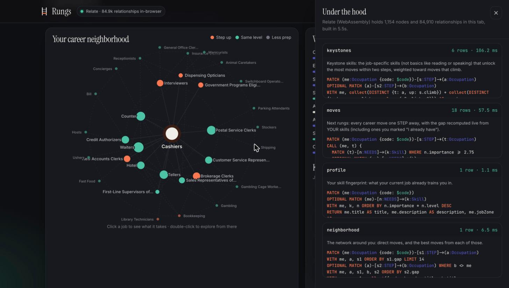
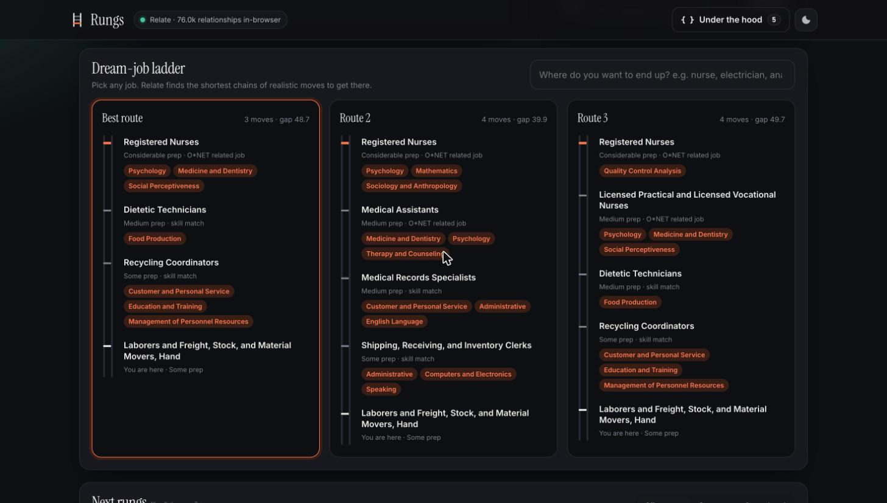

# Rungs 🪜

**Your next job is closer than you think.** Rungs turns every U.S. occupation and the skills they share into a graph, then walks it to show the moves you can realistically make, the shortest route to the job you want, and the one skill that opens the most doors.

**Live demo:** https://davidandree.github.io/rungs/ (runs entirely in your browser on Relate WebAssembly)
**Demo video:** _add YouTube link_

Built for the [Relate by Neo4j Hackathon](https://relate.devpost.com/), "Context, connected."





---

## Use case

Millions of people need a *next* job they can actually get: workers whose roles are being automated, people with injuries who can't keep doing physical work, parents re-entering the workforce, students. Job boards answer "what's open?" They don't answer **"what am I one or two moves away from, and what exactly should I learn?"**

That's a relationships question:

- A **job** connects to the **skills** it needs, at specific levels.
- Two jobs are a realistic **move** when their skill profiles overlap and the target needs at most one more level of training.
- A **career path** is a chain of moves: a *path* in the graph.
- The most valuable skill to learn is the one on the most paths out of where you are now: a *traversal* question.

| Who | What Rungs gives them |
|---|---|
| Career changers and displaced workers | Realistic next moves ranked by readiness, plus a multi-step ladder to a dream job with skills per rung |
| Students | What their first job leads to, and which skill unlocks the most options |
| Workforce boards and career counselors | A free, private tool to use with clients, plus a reverse view ("which jobs feed into LPN?") for program design |

## How it uses Relate

- **Mode:** **single file** (`data/rungs.rl`) for the persistent store; **in-memory** in the browser (WebAssembly).
- **Why this mode:**
  - The single `.rl` file is one portable artifact in git. Judges can inspect it with one command, it works unchanged with the CLI, Python, and `relate serve --mcp`, and `--read-only` guarantees nobody mutates it by accident.
  - The browser build can't open an `.rl` file directly, so the web app rebuilds the *identical* graph in memory from `docs/graph.json` using the same `UNWIND … CREATE` statements as the Python build. That takes about 4–5 seconds in a Web Worker, with the occupations loaded first so search works almost immediately.
- **What the graph models:**

```
(:Occupation {code, title, description, jobZone, titles[]})       910
(:Skill {id, name, kind: essential|transferable|knowledge})        68
(:Software {name})                                                 176 "hot technologies"

(:Occupation)-[:NEEDS {importance, level}]->(:Skill)            40,236
(:Occupation)-[:USES {inDemand}]->(:Software)                   11,412
(:Occupation)-[:RELATED {tier, rank, gap, climb, newSkills}]->(:Occupation)  8,900  O*NET's curated related jobs (primary tiers)
(:Occupation)-[:STEP {similarity, gap, climb, newSkills}]->(:Occupation)  15,486  realistic moves
```

Two kinds of move edge feed the dream-job ladder. `RELATED` edges are O*NET analysts' own related-occupation lists, which capture field pivots such as orderly → nursing assistant. `STEP` edges are computed in `scripts/build_graph.py`. For each job: its 12 most similar jobs (cosine similarity of importance×level skill vectors), plus its 6 closest jobs exactly one Job Zone up, so upward moves always exist. A move never climbs more than one Job Zone. `gap` sums the missing skill levels weighted by importance, and `newSkills` lists the skills to build.

### The Cypher behind each feature

All app queries live in [`docs/js/queries.js`](docs/js/queries.js) and appear verbatim, with timings, in the app's **Under the hood** drawer.

| Feature | Relate feature used | Typical time (WASM) |
|---|---|---|
| Next rungs, re-scored live from skills you mark as yours | `CALL (me, t) { … }` scoped subqueries, `OPTIONAL MATCH`, list params | ~50 ms |
| Dream-job ladder | `SHORTEST 48 (me)-[:STEP\|RELATED]->{1,6}(goal)` over two edge types, loops filtered with `single()`, then each stepping stone scored by its own skill gap to the goal in a `CALL` subquery | ~0.5 s |
| Career neighborhood graph | two-hop expansion with per-hop `ORDER BY … LIMIT` | ~10 ms |
| Keystone skills | two-hop reach, then a `NEEDS` deficit count | ~100 ms |
| Search over ~54,000 job titles | list predicates over `titles` | ~50 ms |

## Setup and run

### 1. Just try it (no install)
Open **https://davidandree.github.io/rungs/** in a recent Chrome, Edge, Firefox or Safari. Click **Cashier**, then press **Set as goal** on any move, or type a goal like "nurse". Open **Under the hood** to see every Cypher query.

### 2. Query the persistent store with the Relate CLI

```bash
brew install relatedb/tap/relate          # or: curl -sSfL https://relatedb.ai/install.sh | bash
git clone https://github.com/DavidAndree/rungs.git && cd rungs

relate query -d data/rungs.rl --read-only < queries/01-what-is-in-the-graph.cypher
relate query -d data/rungs.rl --read-only --param 'code="41-2011.00"' < queries/02-next-moves.cypher
relate query -d data/rungs.rl --read-only --param 'from="41-2011.00"' --param 'to="29-1141.00"' < queries/03-dream-job-ladder.cypher
relate query -d data/rungs.rl --read-only --param 'code="35-2014.00"' < queries/04-keystone-skills.cypher
relate query -d data/rungs.rl --read-only --param 'code="29-2061.00"' < queries/05-who-can-fill-this-role.cypher
```

Occupation codes are O*NET-SOC codes: `41-2011.00` Cashiers, `35-2014.00` Restaurant Cooks, `53-7062.00` Laborers/Freight Movers, `29-1141.00` Registered Nurses, `29-2061.00` Licensed Practical Nurses, `15-1252.00` Software Developers. Find any other with:

```bash
relate query -d data/rungs.rl --read-only "MATCH (o:Occupation) WHERE toLower(o.title) CONTAINS 'electric' RETURN o.code, o.title"
```

### 3. Use it from an AI agent (MCP)
`.mcp.json` registers Relate's MCP server over stdio, read-only:

```bash
cd rungs && claude      # Claude Code picks up .mcp.json → approve "rungs"
```

Then ask "I'm a line cook. What can I move into without a degree?" See [AGENT.md](AGENT.md) for the system prompt and more questions.

### 4. Run the web app locally

```bash
npm run serve           # serves docs/ at http://localhost:8000
```

### 5. Rebuild the graph from source data
Requires Python 3.10+.

```bash
./scripts/fetch_onet.sh                      # downloads 8 O*NET 31.0 CSVs into data/onet/
python3 -m venv .venv && .venv/bin/pip install -r requirements.txt
.venv/bin/python scripts/build_graph.py      # writes data/rungs.rl + docs/graph.json (~1 min)
npm install && npm test                      # loads graph.json into Relate WASM and runs every app query
```

## Where the data lives

| Path | What |
|---|---|
| **`data/rungs.rl`** | **The persistent Relate store**: single-file bundle, about 76,000 relationships |
| `docs/graph.json` | The same graph as JSON, loaded into Relate WASM by the web app |
| `queries/*.cypher` | Ready-to-run CLI queries |
| `scripts/build_graph.py` | O*NET → graph build, including `STEP` edge computation |
| `docs/` | The web app (GitHub Pages): `js/worker.js` runs Relate WASM, `js/queries.js` holds all Cypher |

## Market

- **Scale:** McKinsey Global Institute estimated in 2023 that an additional ~12 million occupational transitions may be needed in the U.S. by 2030 as automation and AI reshape work, on top of the millions of people who change careers every year anyway. The U.S. public workforce system (American Job Centers) exists to serve exactly these people.
- **The gap:** existing tools stop at listings (job boards) or at single-hop "similar jobs" lists. Commercial skills-graph platforms exist for HR departments and are priced for enterprises. Rungs puts multi-step, skills-gap-aware career paths in front of the worker, for free, with no account, and private, since nothing leaves the browser.
- **Path to sustainability:** licensed deployments for workforce boards and colleges (custom local job data, counselor dashboards), with the public tool staying free.

## Limitations

- O*NET describes national occupations, not specific employers or local openings. Rungs shows where you *could* go, not who's hiring.
- Wage data (BLS OEWS) isn't included yet. It's the top next step, so moves can be ranked by pay gain.
- Some careers are entered through apprenticeships or licensing (for example, electricians), which a skills dataset can't see, so a few routes take unusual stepping stones. The "Under the hood" drawer shows exactly why each route was chosen.
- Skill gaps use O*NET's 0–7 level scale. They're a guide for what to learn, not a hiring guarantee.
- The first browser load downloads ~0.8 MB of graph data plus the ~7 MB Relate WASM engine. Both are cached afterwards.

## Tech and credits

- [Relate by Neo4j](https://relatedb.ai/) 1.2.0: Python (`relate-db`) for the build, CLI and MCP server for the store, `@relate/relate-wasm` in the browser
- [d3-force](https://d3js.org/) for the career-neighborhood network
- Vanilla JS modules, no framework or build step, hosted on GitHub Pages

**AI-assisted development:** built with Claude (Anthropic) as a coding assistant for code, queries, design and docs. Data modeling choices, testing and the submission were directed by me.

**Data attribution:** This project incorporates information from the [O*NET 31.0 Database](https://www.onetcenter.org/database.html) by the U.S. Department of Labor, Employment and Training Administration (USDOL/ETA). Used under the [CC BY 4.0](https://creativecommons.org/licenses/by/4.0/) license. O*NET® is a trademark of USDOL/ETA. Rungs has modified all or some of this information. USDOL/ETA has not approved, endorsed, or tested these modifications.

**License:** code under MIT ([LICENSE](LICENSE)); data under CC BY 4.0 as above.
